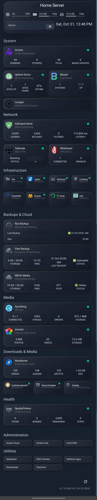

# Homepage Custom CSS

Custom styling for [Homepage](https://gethomepage.dev), a self-hosted dashboard. Glass-style cards, a compact 4-column Infrastructure row, and paired cards in Monitoring and Network.
  
  
## How to use

1. Copy the contents of `homepage-custom-css-public.txt`.
2. Paste it into your Homepage custom CSS file (`/opt/homepage/config/custom.css`).
3. Save and reload the page.

## Service names this CSS expects

The layout matches cards by name, so your services should use these exact names in `services.yaml`:

- **Monitoring:** Uptime Kuma, Beszel
- **Network:** AdGuard Home, Tailscale, WireGuard
- **Infrastructure:** File, Joplin, Watcharr, Linkding, FreshRSS, Dozzle, Dev Tools, ntfy
- **Downloads & Media:** Navidrome, Audiobookshelf, MusicGrabber, AriaNg

If your names differ, change the matching names in the CSS, or the layout won't apply.

## Notes

- The title is set in the CSS. Change the text inside `content: "Home Server";` to your own.
- Tested on Android Chrome. Other browsers may look slightly different.
- Blur effects are heavy on phones. Reduce `backdrop-filter` values if the page feels slow.

## Not included

This repository has only CSS. Your `services.yaml`, `settings.yaml`, and `widgets.yaml` are private and should not be shared, since they contain service addresses and may contain API keys.
